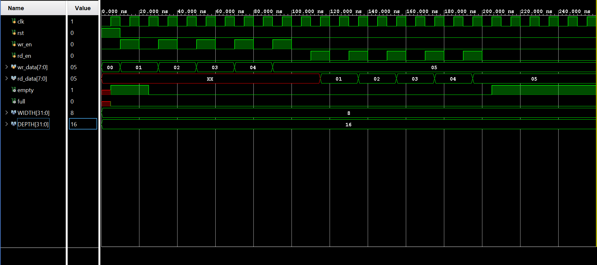
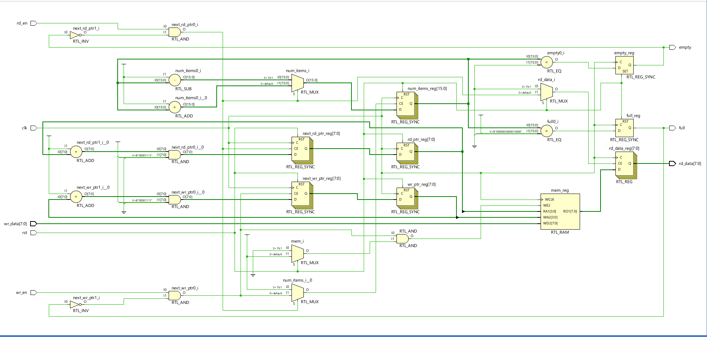
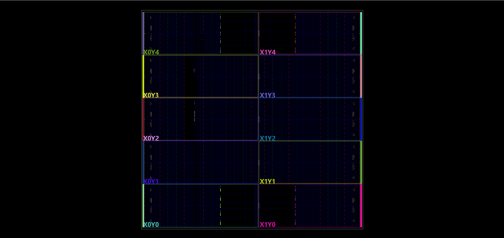
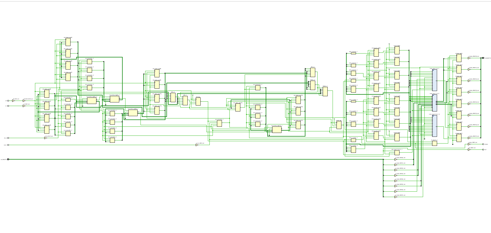
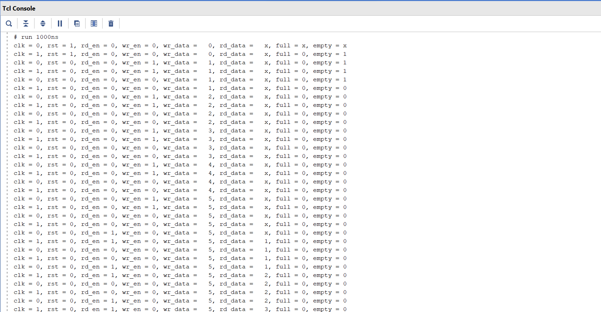

# Synchronous FIFO Design in Verilog

A parameterized **Synchronous First-In, First-Out (FIFO)** memory designed using Verilog HDL and verified through simulation and synthesis in Xilinx Vivado.

## Overview

A FIFO is a memory structure that follows the **First-In, First-Out** principle: the first data written is the first data read. It is commonly used for buffering data and managing data transfer between digital hardware modules.

This project implements a synchronous FIFO with an 8-bit data width and a depth of 16 entries, using read and write pointers and full/empty status flags.

## Features

- 8-bit data width and 16-entry storage depth
- Synchronous read and write operations
- Modular memory array
- Read and write pointer management
- Full and empty status flag generation
- Verilog testbench for functional verification
- RTL simulation and waveform analysis
- Synthesis, schematic, resource utilization, and power analysis using Xilinx Vivado

## Tools & Technologies

- **HDL:** Verilog
- **Simulation & Synthesis:** Xilinx Vivado
- **Verification:** Testbench development and waveform analysis
- **Design Concepts:** FIFO architecture, pointers, memory arrays, control logic, RTL design

## Project Structure

```text
synchronous-fifo-verilog/
├── FIFO.v
├── FIFO_tb.v
├── Implementation.png
├── Power Usage.png
├── Resource Utilization.png
├── Schematic.png
├── Simulation.png
├── Synthesis.png
├── Tcl_Console.png
└── README.md
```

## Architecture

The FIFO consists of the following main components:

- **Memory Array:** Stores data entries until they are read.
- **Write Pointer:** Tracks the location for the next write operation.
- **Read Pointer:** Tracks the location for the next read operation.
- **Control Logic:** Manages FIFO read/write behavior and status flags.
- **Full Flag:** Indicates when the FIFO has reached its storage capacity.
- **Empty Flag:** Indicates when the FIFO contains no data to read.

All operations are synchronized with the clock.

## Verification

The design was verified using a dedicated Verilog testbench and RTL simulation in Xilinx Vivado.

The verification workflow includes:

1. RTL simulation of FIFO operations.
2. Waveform inspection to observe clock, control signals, data, and status flags.
3. RTL synthesis and schematic inspection.
4. Review of implementation reports, resource utilization, and power estimates.

### Simulation Waveform



### RTL Schematic



### Synthesis Results



### Implementation Results



### Resource Utilization


### Power Analysis


### Tcl Console



## Learning Outcomes

Through this project, I gained practical experience in:

- RTL design using Verilog HDL
- Synchronous digital circuit design
- FIFO memory architecture and pointer management
- Testbench development and simulation-based verification
- Waveform analysis and debugging
- RTL synthesis and hardware resource analysis using Vivado

## Repository

**GitHub:** [synchronous-fifo-verilog](https://github.com/vs2311/synchronous-fifo-verilog)

---

*Developed as a digital design project to strengthen fundamentals in Verilog HDL, RTL design, and functional verification.*
